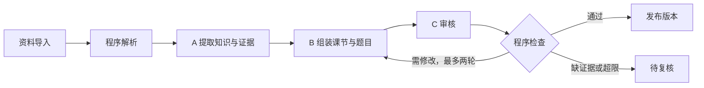
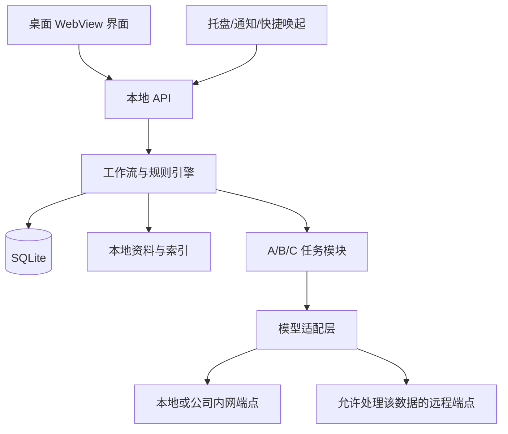

# 入职培训记忆助手：产品需求文档与研发指南

版本：v1.0（研发基线草案）  
整理日期：2026-09-23（按本会话提供的日期）  
状态：可用于原型与 MVP 开发；尚未进行用户试验或模型质量实测  
暂定名称：入职培训记忆助手；正式品牌名称待定

## 0. 如何使用本文件

本文件整合当前会话及两个项目内讨论记录，以当前会话最新的用户纠偏为最高优先级。本文中的“必须”是产品要求；技术栈、题量、分数阈值、复习间隔和试点指标是首版建议，不是已验证的科学结论。

开发时遵循：先实现可靠的固定流程，再接入模型；先跑通一章培训内容，再扩大课程；先验证记忆收益和使用负担，再扩展奖励与桌宠。

参考会话：

- [提出学习产品奖励机制](codex://threads/01a0a9ae-8622-7b30-9d90-be3af0caefe0)
- [规划产品并头脑风暴](codex://threads/01a06b6a-5a3b-72d2-b0b3-9ee5bf46bf1e)

### 0.1 已确定、默认方案与待验证事项

| 类型 | 内容 |
|---|---|
| 已确定的定位 | 云厂商校招新人，入职培训期，纯理论知识学习与记忆 |
| 已确定的形态 | 网页技术界面＋轻量桌面外壳＋本地后端；本地优先 |
| 已确定的后台角色 | 知识管理、学习安排与出题、质量评审三个 Agent |
| 已采纳的设计 | 课程骨架与材料分离；工作文档提供学习线索；低门槛个人沉淀 |
| 当前默认 | 单用户、Windows 优先；一套成熟培训课程的一章作为首个试点 |
| 待验证参数 | 分数线、复习间隔、题量、提醒频率、奖励规则和试点门槛 |
| 待实现前配置 | 可用模型端点、电脑硬件、材料使用范围、实际培训材料、试点参与者 |

### 0.2 对历史构想的裁剪

| 历史构想 | 当前处理 |
|---|---|
| 客户模拟、独立架构设计、售前作战包 | 排除，不属于当前产品 |
| Linux/容器实际操作与实验判分 | 排除；可以阅读相关理论材料，但不考操作能力 |
| 新人与老员工双模式、跨岗位路径 | 排除，聚焦校招培训期 |
| 综合能力百分比、未经校准的答对概率 | 排除；使用有证据的分维度状态 |
| 多货币、商店、社交排行榜、抽奖 | 首版排除，避免奖励系统大于学习系统 |
| 连续签到、断签清零、宠物挨饿 | 排除 |
| 弹性周目标、具体进步反馈、低负担回归 | 保留 |
| 大型知识图谱 | 后置；底层保存关系，首版用关系卡与列表展示 |
| 桌宠 | 后置；首版提供托盘、提醒、简洁成长反馈 |
| 多模型、云同步、任意视频自动解析 | 后置，不能成为首版交付前提 |

## 1. 产品定位与价值

### 1.1 一句话介绍

一款陪云厂商校招新人度过入职培训期的桌面记忆助手：围绕正在学习的培训材料，课后主动回忆、后续少量复习，让本周学过的理论知识下周仍能说清。

### 1.2 技术形态

它是采用网页技术开发界面的轻量桌面应用。桌面外壳提供托盘、定时提醒、快捷唤起和可选自启；本地后端完成解析、检索、Agent 编排、复习与评分；本地数据库和文件保存资料与学习历史。统一模型接口可连接本地推理服务或获准使用的远程模型。

桌面外壳不仅是网站启动器。关闭学习窗口后，用户允许的后台服务仍能提供提醒；退出整个应用后则不承诺继续提醒。无需先购买云服务器。

### 1.3 目标用户与窄场景

- 用户：入职约三个月内、正在参加公司培训的云厂商校招新人。
- 内容：当前培训中的基础概念、技术原理和公司产品理论知识。
- 首个内容范围：一套已有讲义或字幕的成熟培训课程的一章，约 15—30 个知识点。
- 主场景 A：一节培训结束后，用约 3 分钟回忆关键内容并纠错。
- 主场景 B：下一个工作日的自选时段，用约 5 分钟复习少量值得复习的内容。
- 次场景：主动整理一句疑问、mentor 的纠正，或查看本周仍混淆的概念。
- 不要求用户自行设计完整课程、每天整理长笔记或反复配置提示词。

“3 分钟”和“5 分钟”是体验预算，不是强制倒计时。首版默认不超过三道短题；预计时间不足时只选一到两题。

### 1.4 理论能力边界

1. 记忆：脱离材料回忆定义、组成、关系或必要条件。
2. 理解：解释原因、辨析概念、指出理论错误与适用边界。
3. 关联：准确说明两个或多个已学知识之间的关系。

理论例子可以用来检验解释与边界，不得扩展为命令执行、部署实验、客户沟通或解决方案设计。三个维度独立记录，不合成“职业能力分”。

## 2. 痛点、应对与成功证据

| 痛点 | 产品应对 | 可观察的证据 |
|---|---|---|
| 学完很快忘记 | 主动回忆与跨天复习 | 无提示延迟作答表现 |
| 看懂却说不出 | 先作答后看解析 | 独立生成回答，而非只识别选项 |
| 概念混淆、知识孤立 | 辨析题、关联题、误区记录 | 换一种问法仍能解释区别与联系 |
| 不知道复习什么 | 依据到期情况、错误和提示记录选题 | 少量题能覆盖当前主要薄弱点 |
| 笔记零散、维护成本高 | 导入一次、按课节归档、短句沉淀 | 日常无需反复整理资料 |
| 学习反馈弱，容易吃灰 | 前后回答对比、具体表扬、掌握后减少复习 | 用户感受到进步并愿意再次使用 |
| AI 与资料可能不可靠 | 引用、版本、题目审核、申诉 | 错误可发现、可撤销、可追溯 |

产品的差异化是保存长期学习证据并据此主动安排短复习，而不是声称通用 AI 没有记忆或不具备资料检索能力。

## 3. 范围与完整功能清单

P0＝首个可持续自用 MVP 必须；P1＝试点后增强；P2＝明确后置。

| ID | 功能 | 级别 | 具体边界 |
|---|---|---|---|
| F01 | 首次设置 | P0 | 单用户、模型连通、数据目录、提醒时段、每周目标 |
| F02 | 培训课接入 | P0 | 课程/章节/学习目标，沿用成熟目录；支持手工修改 |
| F03 | 资料导入 | P0 | UTF-8 TXT/Markdown、文本型 PDF、SRT/VTT、链接收藏 |
| F04 | 资料处理状态 | P0 | 进度、失败原因、重试、仅链接状态、出处定位 |
| F05 | 知识条目 | P0 | 定义、条件、来源、易混淆点、关联、版本 |
| F06 | 课后回忆 | P0 | 当前课节，少量短题，先答后看，反馈后修正 |
| F07 | 每日复习 | P0 | 到期挑选、题量预算、暂停、延期、无任务空状态 |
| F08 | 理论题与提示 | P0 | 回忆、解释、辨析、纠错、关联、边界六种考查意图 |
| F09 | 评分反馈 | P0 | 要点、原文证据、错误类型、具体改进、不确定则待复核 |
| F10 | 异议反馈 | P0 | 用户申诉、冻结影响、复核、撤销/重算 |
| F11 | 记忆证据展示 | P0 | 记忆/理解/关联状态、待验证、待修复、历史回答对比 |
| F12 | 轻量激励 | P0 | 单一成长积分、具体表扬、弹性周目标，无签到奖励 |
| F13 | 个人短记录 | P0 | 一句疑问/纠正/摘录；人工选择关联知识点 |
| F14 | 桌面入口 | P0 | 单实例、托盘、通知、可选自启、关闭与退出区别 |
| F15 | 内容维护 | P0 | 草稿、审核、发布、停用、版本与来源状态 |
| F16 | 数据管理 | P0 | 导出、备份、恢复、模型配置与数据路由 |
| F17 | 材料内定向问答 | P1 | 仅当前课节及相关知识，不做通用聊天大厅 |
| F18 | 自动工作关联 | P1 | 从工作文档发现候选概念，不自动改公共事实 |
| F19 | 扩展解析 | P1 | DOCX/PPTX、扫描 OCR、图表，逐种验证 |
| F20 | 受控联网补缺 | P1 | 针对明确缺口检索、候选区、来源核验，不自动编全课 |
| F21 | 更丰富的进步回顾 | P1 | 周报、徽章、可导出的个人学习记录 |
| F22 | 桌宠、成长外观 | P2 | 作为学习反馈载体，不能影响能力判断 |
| F23 | 多端同步、团队课程分发 | P2 | 新增账号、权限、冲突处理后独立设计 |
| F24 | 自适应记忆模型 | P2 | 足够数据和对照评估后考虑，不直接展示未校准概率 |

不做：实验沙箱、操作自动化、客户模拟、方案生成、老员工调研模式、课程交易、考试作弊辅助、社交排行榜、付费抽卡或无限任务流。

## 4. 页面与用户流程

### 4.1 最少页面

| 页面 | 核心信息与动作 |
|---|---|
| 今日 | 当前课节；课后回忆入口；今日建议复习；暂停/改时段 |
| 课程与资料 | 目录、材料、解析状态、来源和版本 |
| 回答 | 一道题、作答框、可选把握程度、提示/不知道/跳过 |
| 反馈 | 得分或待复核、要点对照、出处、修正、申诉 |
| 成长 | 三维学习证据、混淆点、前后回答、周目标 |
| 设置与维护 | 模型、提醒、后台状态、内容维护、导出备份 |

不把 Agent 名称、检索参数、向量距离放进日常学习页面。

### 4.2 首次使用

1. 用户选择数据目录，配置可用模型；也可先进入预置内容演示。
2. 选择提醒时段与每周目标，默认建议每周三个工作日，可关闭提醒。
3. 导入一章材料或打开预置公开示例，确认目录和课节。
4. 后台处理材料、准备少量题目；前台展示状态，不阻塞整个应用。
5. 已准备课节可直接开始，其余仍显示处理中。

演示题与固定示例反馈必须标记；没有真实模型运行时，不能伪装成实时 AI 生成。

### 4.3 课后回忆

1. 用户选择刚学过的课节，记录一次学习接触时间。
2. 后端选出最多三道短题，每题有一个主要知识点与主要考查维度。
3. 用户先回答，可选择“不知道”、提示或跳过；把握程度可不填。
4. 答案落库后评分，返回证据反馈。用户查看解析时记录新的知识接触。
5. 错误题可提交一次修正；同日修正仅作练习证据，不升级长期记忆状态。
6. 明确结束：“本次完成；下次建议在……”。不自动延长会话。

### 4.4 次日与后续复习

1. 本地调度器产生到期候选，不预先生成大量通知。
2. 在用户允许的时段推送一次可关闭提醒；无任务不推。
3. 用户打开后，选题考虑当前时间预算和最新状态。
4. 每题展示简短理由，如“上次这两个概念仍混淆”。
5. 合格后延长间隔，错误后补充解释，结束时反馈具体进步。

### 4.5 中断与回归

- 七天以上没有有效学习时，下一次打开使用回归模式；阈值可配置。
- 仅挑选最多三个高价值知识点，不要求清空积压。
- 保留历史证据与积分，不使用惩罚性清零。
- 回归奖励只允许一次里程碑展示，不因反复离开重复发币。
- 到期不等于遗忘；未作答不能判错。

## 5. 学习与选题机制

### 5.1 基本原则

核心循环：学习材料 → 关闭材料主动提取 → 反馈纠错 → 跨天变式提取 → 理解辨析与关联 → 延长复习。

研究支持主动提取和分散练习的价值，但不能由此推导本文中的 80 分、三题或固定天数是最优参数。首版使用透明规则，方便解释、测试和调整。

### 5.2 调度单位

复习状态按 `用户 × 知识点 × 维度` 保存。每题有一个主要调度目标；其他知识点仅记录附带观察，不因一道综合题给多个知识点同时升级。

关联题另外绑定知识关系 ID；只有确实考查并评分的关系才获得证据。不存在合适关联目标的知识点显示“不适用”，不能显示为零分或薄弱点。

### 5.3 题型与难度

| 考查意图 | 例子形式 | 默认维度 |
|---|---|---|
| 回忆 | 复述概念、组成或必要条件 | 记忆 |
| 解释 | 为什么成立、因果关系是什么 | 理解 |
| 辨析 | 两个概念在某维度有何不同 | 理解 |
| 纠错 | 找出一段理论解释的错误并修正 | 理解 |
| 关联 | 两个已学概念如何联系 | 关联 |
| 边界 | 一个说法在什么前提下成立 | 理解 |

难度为 D1 单一要点、D2 多要点解释/对比、D3 多知识关系与边界。D3 仍为理论，不自动变成方案题。

首版交互形式优先简答、填空、单选。纯单选只产生“识别证据”，不能单独推动自主回忆状态；带独立解释的题按解释部分单独评分。不要一开始实现复杂多选部分得分。

### 5.4 候选选择算法

先过滤：已发布、来源可用、目标已学、前置满足、没有争议冻结、题目与评分版本完整。

默认顺序：

1. 到期且存在核心错误，或高把握却答错的目标。
2. 其他到期目标，按逾期程度排序；同层用上次展示时间避免反复挑同一个。
3. 已学但尚无独立验证的目标。
4. 用户主动开始当前课节时，才加入新学目标。

复习入口不会擅自加入未学新章节；所有薄弱点仍须尊重最早复测时间，不每次打开都重复考。目标选中后，在同等难度和评分要点的题族内轮换问法；普通顺序改变不构成真正新题。

默认最多三题，并累计预计时长不超过约五分钟。无合格候选时显示“当前没有需要复习的内容”，不临时放宽质量要求。

### 5.5 复习间隔算法 v1

间隔数组 `I = [1, 3, 7, 14, 30]`，单位为日历天，表示距最近一次有效复习后的等待时长，不是距首次学习的固定日期。

| 本次结果 | 调度动作 |
|---|---|
| 首次学习或首次独立作答 | `stage=0`，最早次日复测；即刻正确不跳档 |
| 到期后首次作答，独立 ≥80 且无核心错误 | `stage=min(stage+1,4)`，从本次完成计算下一档间隔 |
| 60—79，无核心错误 | 不升档，按当前档安排；进入针对性补充 |
| <60，或核心错误，或明确选择“不知道” | 重置 `stage=0`，次日安排；保留历史成功证据 |
| 提示/查看材料后才作答 | 不升档；从接触时间起次日验证 |
| 同日修正或提前主动复习 | 不升档，不算延迟独立证据；记录新接触，避免紧接着再测 |
| 跳过/取消/模型失败/题目待复核 | 不记错、不升降档；保持或冻结原安排 |

例如首次学习在第 0 天，连续按期合格，复习出现在第 1、4、11、25、55 天。达到最后一档后维持约 30 天，用户可以主动暂停。

对 60—79 分且当前档已较长的情况，先用规则记录实际效果；试点可引入更短的补充间隔，但必须更新策略版本，不能由模型自由改天数。

下一次验证不得早于最后一次已知相关内容接触后的 24 小时。非学习日或暂停期间，提醒顺延至下一个允许时段，证据间隔使用真实经过时间。过期只产生 `due` 状态，不自动降低分数。

### 5.6 内容接触与延迟证据

后端记录查看解析、打开相关材料、获得提示、纠错学习等 `ExposureEvent`。延迟天数按“本次回答之前最近一次已知相关内容接触”计算，而非只看最初学习日期。接触范围尽量限定到当前页、字幕片段或学习单元映射的知识点；仅浏览课程目录不算接触全文。无法确定阅读范围时记录范围不确定，对涉及知识的延迟证据采取保守口径，并允许用户纠正。

一次答对但当天刚重读，不能算七天保持。反馈显示之后的新接触影响下次调度，不回头否定本次作答之前的真实间隔。

系统无法知道用户在产品外是否复习，也不监控屏幕。开始延迟测试时可让用户标记“近期看过相关材料”；状态说明为“基于已记录接触”，不能宣称完全测量人的记忆。

## 6. 评分、掌握状态与奖励

### 6.1 三种数据必须分离

- 题目成绩：本次回答相对本题标准的表现。
- 掌握证据：独立性、间隔、题型、难度与历史表现。
- 成长积分：鼓励有效行为的累计奖励，不代表能力。

材料浏览进度单独记录，不自动等同于掌握。模型自报置信度不作为上述任何分数。

### 6.2 简答评分

题目发布前固定要点 `criterion`、权重、部分满足标准、可接受表达和核心错误。权重总和为 100。

每项取值：未满足 0、部分满足 0.5、满足 1。若无法确定语义或证据，整题进入待复核，不把未知当零分。总分由程序计算并四舍五入，不由模型任意输出。

`score_raw = round(Σ weight_i × level_i)`

出现预定义、经审核且可定位到回答的核心错误时：`score = min(score_raw, 59)`；否则 `score=score_raw`。核心错误不是任何遗漏，而是会推翻关键理解的错误陈述；不能临时创造封顶理由。

示意评分表（非正式题库内容）：

| 要点 | 权重 | 判定要求 |
|---|---:|---|
| 概念 A 的必要定义 | 40 | 包含规定的关键属性，允许同义表达 |
| 概念 B 的必要定义 | 40 | 同上 |
| 二者的一条关键关系 | 20 | 明确题目要求的关系 |

比如得到 1、0.5、1，总分为 80。只出现术语而没有正确命题不能判满足；文风、长度、拼写小错不单独扣分，除非影响语义。

客观单选题答对 100、答错 0，主要用于筛查与热身，不单独升级自主回忆。空白提交提示补充；“不知道”作为合法低表现，跳过是未完成，两者分开。

### 6.3 独立性

`independence = independent | hinted | open_material | correction | unknown`

同一会话、同一目标，第一次看到答案前的作答才可能为独立证据。使用提示、已展示参考答案、重新作答，都不能通过重新创建题目来恢复独立标记。后端校验状态，不信任前端传入的 `is_independent`。

### 6.4 掌握状态

为避免“待复习”与“曾经巩固”互相覆盖，采用两个字段：历史证据等级 `evidence_level` 与当前行动状态 `action_status`。

| 历史等级 | 首版要求 |
|---|---|
| 未验证 | 没有该维度有效的独立生成式合格证据 |
| 初步掌握 | 至少一次独立 ≥80，且无核心错误 |
| 已巩固 | 不同日期至少两次独立合格，题目不是同一原题，至少一次距上次已知相关内容接触 ≥7×24 小时 |
| 长期保持有证据 | 满足已巩固，并至少一次独立合格距上次已知相关内容接触 ≥30×24 小时 |

`action_status = normal | due | needs_repair | pending_review | content_changed | paused`

新错误产生 `needs_repair`，不删除历史；通过新的独立合格验证后才能解除待修复。到期仅变为 `due`。知识实质变更后标记 `content_changed`，旧版本的成功不能冒充新版本验证。

前台呈现：“记忆：已有七天间隔证据，当前待复习”“理解：上次出现概念混淆，需修复”。不展示总掌握率 87% 或答对概率 62%。汇总数量必须给出分母和维度，课程内容新增时不能制造用户退步假象。

### 6.5 成长积分

| 有效行为 | 当日该主要知识点可达到的积分档位 |
|---|---:|
| 独立尝试后完成经检查的有效修正，或辅助完成合格回答 | 1 |
| 首次独立合格 | 2 |
| 到期且真实间隔 ≥24 小时的独立合格 | 3 |

同一用户、同一知识点、同一本地日期取最高档，最多 3 分。先得 1 再得 3 只补 2；不能每题叠加。纯单选最多按有效参与给 1，不给独立生成式的 2/3 分。单纯打开、播放、抄贴参考答案或重复原题不给主要奖励。

不能完美识别外部抄答案，首版不做监考；通过低奖励、有限题量、历史对比减少刷分动机。积分只关联外观或纪念记录，不购买能力等级。

有效学习日：至少完成一次可判定的独立生成式合格作答，或一次有效尝试及经检查的修正；纯选择题识别、题量和停留时间不能单独认定。周目标默认三个自选工作日，可改可关；中断不扣分、不清空历史。目标变更次周生效，当前周显示旧目标，避免反复修改领取奖励。

具体表扬从结构化证据生成，例如“上次需要提示，这次独立说出了两项区别”。只有一次表现时用“这次做到了”，不能夸成“已完全掌握”。

## 7. 出题与质量治理

### 7.1 题目生产流程

已核验来源 → 学习目标 → 评分要点与核心误区 → 题干与参考答案 → C 审核 → 程序检查 → 发布。

每题必须具备：题目 ID/版本、主要知识点/维度、题族 ID、难度、已教范围、来源片段与定位、参考答案、权重与评分锚点、核心错误列表、允许表达、审核记录、预计答题时间。

先准备题库，再在线抽题；题量不足时在后台补充，用户不必每答一道题等整个生成链路。变式题必须保持目标、难度和核心评分点相近；不能只因文字不同就认定具有新验证价值。

### 7.2 发布状态

`draft → reviewing → approved → published → retired`

审核失败进入 `needs_revision`；缺证据或有歧义进入 `blocked`。修改最多两轮，仍不合格停止并展示原因。版本一旦发布不可原地覆盖，修订产生新版本。

自动审查通过的派生题标注“基于来源生成，自动检查通过”；专家实际确认后才可标注“专家审核”。用户确认目录不等于专家确认知识正确。

### 7.3 质量门槛

| 层级 | 必须检查的内容 | 未通过处理 |
|---|---|---|
| 原始资料 | 可获取正文；位置准确；版本与适用范围明确 | 仅收藏或待核验 |
| 知识条目 | 原文蕴含结论；条件保留；冲突有标记 | 不进入正式出题池 |
| 课程 | 目标、材料、题目一致；前置要求明确 | 调整目录或限制题目 |
| 题目 | 已教可答、条件足够、无非预期歧义、无答案泄漏 | 修改或阻断 |
| 评分规则 | 权重和为 100；部分满足可辨；合理同义答案可接受 | 不发布 |
| 作答评价 | 每项结论有回答依据；不按字数；矛盾有解释 | 待复核 |
| 反馈 | 正确指出差异并有来源；无编造表扬 | 使用简短结构化反馈或复核 |

Schema 合格只能证明格式合法，不能证明内容真实；多个角色共用模型时可能共享错误。C 应先基于题目和原文独立检查可答性，再比对 B 的参考答案，降低直接照抄答案的风险，但仍不视为独立专家证明。

### 7.4 申诉与影响修复

用户可选择“答案合理被判错、题意不清、资料过期、来源不支持、其他”，可附一段理由。受影响评价改为待复核，暂停其能力和积分影响，不抹除原始记录。

C 重新检查；需要来源核查时调度 A。无法解决则保留待复核，不自动强判。复核成立后新增替代评价，旧评价标记失效；程序按有效事件重新计算对应状态与奖励。发现整题有问题时停用该版本，重新处理该版本影响过的所有作答。

积分账本追加补偿记录，不能直接无痕改总分；仅撤销错误造成的影响，不进行惩罚。重算按事件实际发生顺序及当时的策略版本进行，历史曝光、提示、时区与题目版本也必须保留；不要用今天的新策略无提示地重算所有过去成绩。

### 7.5 小模型质量策略

- 一次任务只处理一个学习单元或一道题，控制上下文。
- 用可靠来源、少量标注例子和固定 schema 限定任务。
- 程序承担加权计算、调度、版本、规则校验和幂等。
- 检索不到依据就返回缺口，不凭模型常识补成正式知识。
- 模型可对接本地、公司批准端点或其他获准服务；不锁定型号。
- 使用公开/合成数据先评测。强模型生成内容也需同样质量门槛。
- 建立覆盖同义表达、部分正确、核心错误、歧义、长篇空话的评分样本集。

## 8. 知识库与课程构建

### 8.1 课程不是从零设计

一门课采用一条成熟主线，保留章节顺序；平台增加回忆、反馈和复习。官方入门课程、系统教材、公司培训大纲分别提供教学结构和岗位范围。不同来源只作为局部补充，不自动拼出一套“完整课程”。

开发者不需要当课程专家。可请 mentor 对目录范围、关键误区和少量核心题抽检；没有专家参与就明确标记自动整理状态，不宣称专家认证。

### 8.2 来源与用途

| 来源 | 用途 |
|---|---|
| 成熟教材、官方课程、公司培训大纲 | 课程骨架与学习目标 |
| 官方概念/产品文档 | 事实、边界、版本核验 |
| 培训视频字幕、精选 B 站字幕 | 教学解释与示例，保留时间戳 |
| 工作文档 | 候选术语和实际关联，不自动成为通用事实 |
| FAQ、经确认的 mentor 纠正 | 误区、替代表达、补充说明 |
| 个人疑问与错答 | 个体状态，不污染公共知识 |
| 联网结果（P1） | 明确缺口的候选证据，不直接发布 |

### 8.3 摄取流水线

1. 创建来源，保存原文件或链接与内容哈希，设置处理范围。
2. 解析正文、标题、页码、字幕时间段。解析失败保留原件。
3. 按语义与标题切片；保留定义与限制条件，不机械截断表格说明。
4. A 提出知识条目、重复候选、课程归属、关系和冲突。
5. 后端校验来源引用；审核后保存知识版本。
6. B 组装学习单元与少量题目；C 审核；发布后才能进入学习。

来源状态：`collected / parsing / parsed / needs_review / usable / failed / unavailable`。`collected` 的链接没有正文，不允许作为出题依据。扫描 PDF 首版提示不支持或需文本版本，不猜测内容。

### 8.4 知识条目字段

一个条目至少包含：概念名、别名、简明定义、必要条件、理论例子、易混淆项、来源引用、适用产品/版本、相关关系、核验状态、来源内容哈希。

关系类型首版为 `prerequisite_of / contrast_with / part_of / explains / product_mapping`。关系也有来源和状态；AI 推测的关系为候选，不能点亮为用户已掌握。

基础概念可跨课程复用；公司特定定义、不同版本和同名不同义概念必须分开，不能只按名称去重。

### 8.5 存储划分

| 存储 | 内容 |
|---|---|
| 本地文件 | 原文、附件、字幕、允许保存的快照 |
| 关系数据库 | 课程、知识、来源索引、关系、题目、学习与任务状态 |
| 可重建检索索引 | 全文索引；可选语义向量，不作为唯一事实来源 |

首版无需独立图数据库和云端向量数据库。检索先按课程、版本与数据范围过滤，再做关键词/全文；语义检索依据实际召回问题再加入。

来源更新：抓取新快照 → 比较内容 → 标记受影响知识/题目 → 重新审核。未变的条目不重置学习；实质改变的内容需新版本验证。链接失效但有有效本地快照时标记链接不可达，而非自动删除内容。

## 9. 后端 Agent 与工作流

### 9.1 职责

| 模块 | 输入 | 输出 | 不能做的事 |
|---|---|---|---|
| A 知识管理 | 解析材料、查证请求 | 知识候选、证据包、关系与冲突 | 无来源编造事实、直接改个人成绩 |
| B 学习与出题 | 目标、证据包、允许的候选、学习摘要 | 讲解/题目草稿、选题建议 | 任意改规则、越过审核发布 |
| C 质量评审 | 题目或回答、证据、固定标准 | 发布检查、逐项判定、反馈、复核 | 无依据强判、自己写最终积分 |
| 程序调度器 | 事件与当前状态 | 调用顺序、校验、持久化、重试 | 不承担开放式事实编造 |

三个 Agent 是逻辑角色，可共用同一个模型服务并顺序调用，不是三个常驻模型或微服务。普通检索无需每次唤醒 A。

### 9.2 三条工作流



在线学习：读取已发布内容 → 程序选题 → 用户回答 → 客观规则或 C 评价 → 程序校验与计分 → 保存证据/安排/奖励 → 返回反馈。需要补课时才调用 B。

申诉：保存反馈 → 冻结受影响评价 → C 复核 → 必要时 A 查证 → 新评价或待复核 → 程序重放影响。

### 9.3 任务协议

公共任务信封包含 `schema_version / job_id / task_type / input_refs / policy_version / model_profile_id / trace_id`。大段材料使用 ID/版本引用，执行前由后端加载必要片段并组装上下文；不能只给模型一个无法解析的 ID。

结果包含 `status / output / evidence_refs / issues / model_run_id`；结果必须经 schema 与业务规则双重验证。

任务状态：`queued / running / succeeded / retryable_failed / blocked / cancelled`。记录当前步骤、重试次数、输入版本与产物。应用重启后恢复未完成任务；任务取消不删除已保存的用户回答。

传输失败可有限重试；语义质量失败走修订流程，不能当网络失败无限重试。模型输出内容不得拥有调用数据库写任意 SQL 的权限。

## 10. 技术架构与模型调用

### 10.1 推荐首版技术组合（可替换的研发默认）

| 层 | 默认选择 | 理由与限制 |
|---|---|---|
| 界面 | TypeScript＋React＋Vite | 便于网页原型与桌面复用，不强依赖该框架 |
| 桌面 | Tauri | 提供托盘/窗口能力；需处理 Windows 安装与 sidecar 生命周期 |
| 本地后端 | Python＋FastAPI | 资料处理与模型调用集中；打包后作为本地服务进程 |
| 数据库 | SQLite＋迁移脚本 | 单用户、低运维；维护事务、版本与备份 |
| 后台任务 | 数据库任务表＋单 worker | P0 不引入 Redis/Celery/多 Agent 集群 |
| 模型 | Provider Adapter | 首个适配器按可用端点实现；不硬绑定具体品牌/型号 |

这是建议的落地组合，版本应在启动开发时固定并记录。若开发者更熟悉其他桌面栈，可替换，但接口和产品规则不变。

### 10.2 运行结构



自启默认为关闭，提醒须用户配置。关闭窗口可进入托盘并解释一次；“退出应用”明确停止 worker 与提醒。休眠唤醒重新计算到期任务，不能补发大量历史通知。

### 10.3 模型适配层职责

- 统一输入消息、输出 schema、超时、取消、token 预算与用量记录。
- 记录模型标识、提供方、提示模板版本、引用内容版本。
- 支持结构化输出时直接使用；不支持时仍必须解析和校验。
- 不将生成流中的不完整 JSON 或未通过审核的评分直接展示为结论。
- 不因本地模型失败自动把内部材料切换发到公网模型。
- 不强制并行调用三个角色；小设备优先串行，准备任务可后台执行。

P0 模型断开时，可浏览本地材料和历史、进行固定客观题；简答先保存为待评，不伪造结果。重新连接后恢复评分。向量模型、转写、OCR 与远程日志同样受数据路由限制。

### 10.4 数据边界

来源具有 `public / internal / personal` 分类及 `allowed_model_profiles`。派生知识、题目和提示上下文继承最严格范围；无法判断时不向未授权端点发送。

本地 API 仅绑定 loopback，并使用会话令牌及来源校验，避免任意网页直接控制本地接口。模型密钥由后端使用并存入系统凭据存储，不能出现在前端包、导出文件和日志中。

导入材料与联网内容都是数据，不能执行其中的“忽略规则、上传文件”等指令。程序限制可用工具；首版不允许运行模型生成的任意命令。

## 11. 数据模型

所有时间存 UTC，展示和每日奖励采用用户时区；ID 稳定，内容版本不可变。下表为逻辑实体，可按实际实现拆表。

| 实体 | 关键字段 |
|---|---|
| UserSettings | timezone, weekly_goal, study_days, reminder_window, paused_until |
| Course / Unit | title, source_outline_ref, order, prerequisites, objectives, version |
| Source / SourceVersion | type, uri/local_path, hash, sensitivity, allowed_profiles, status, fetched_at |
| SourceChunk | source_version_id, text, page/section/start_ms/end_ms, hash |
| Knowledge / KnowledgeVersion | name, definition, conditions, misconceptions, evidence_refs, status |
| KnowledgeRelation | from_id, to_id, type, evidence_refs, version, status |
| QuestionVersion | family_id, target_id, dimension, format, difficulty, prompt, rubric, refs, status |
| Session | type, selected_question_versions, created_at, state, policy_version |
| Attempt | session_id, question_version_id, submission_id, answer, self_confidence, independence, submitted_at |
| ExposureEvent | knowledge_version_id, type, occurred_at, source_attempt_id |
| Evaluation | attempt_id, rubric_version, criteria_results, critical_errors, computed_score, status, supersedes_id |
| EvidenceEvent | target_id, dimension, evaluation_id, independent, gap_hours, qualification, valid |
| LearningState | target_id, dimension, stage, next_due_at, evidence_level, action_status, version |
| RewardLedger | knowledge_id, local_date, tier, delta, reason, evaluation_id, reversal_of |
| UserNote | text, kind, linked_knowledge_ids, candidate_status |
| FeedbackCase | target_evaluation_id, reason, resolution, status |
| Job / ModelRun | input_versions, step, status, retry_count, trace_id, model/prompt_version, latency, usage |

必要约束：`submission_id` 幂等；每个有效评价的证据事件不能重复生成；同一知识点当日奖励净值 ≤3；发布题目的权重和必须为 100；评价绑定题目快照；状态更新使用事务或版本校验。

个人理解和已核验知识分表或分实体状态，绝不自动混入同一“正确答案”。

## 12. 前后端接口与端到端数据流

接口是研发契约草案，统一前缀 `/api/v1`。模型密钥、参考答案、评分规则不放入题目展示响应。

| 方法与路径 | 用途 | 返回要点 |
|---|---|---|
| GET /health | 服务/模型就绪情况 | readiness 与可用能力 |
| POST /sources | 文件或链接导入 | 202：source_id, job_id |
| GET /jobs/{id} | 查询处理 | 当前步骤、状态、可重试原因 |
| GET /courses | 课程列表 | 已就绪课节、进度 |
| GET /units/{id} | 课节与材料 | 目标、材料位置、状态 |
| POST /sources/{id}/open | 打开材料并记录接触 | 已记录接触事件 |
| POST /sessions | 创建课后/复习会话 | session_id、选定题目、预计时长 |
| POST /sessions/{id}/questions/{qid}/hints | 请求提示 | 提示内容，记录独立性变化 |
| POST /attempts | 提交回答 | attempt_id、evaluating 或 completed |
| GET /attempts/{id}/result | 获取结果 | 成绩/待复核、要点反馈、引用 |
| POST /attempts/{id}/corrections | 提交修正 | 修正记录，不改原始答案 |
| POST /feedback | 申诉 | case_id、待复核状态 |
| GET /feedback/{id} | 查看复核进度 | 依据、处理状态、影响范围 |
| GET /learning-state | 个人状态 | 三维证据、due/repair 等状态 |
| POST /notes | 保存一句沉淀 | note_id 与候选关联 |
| PATCH /settings | 提醒、计划、模型配置 | 设置版本 |
| POST /backups | 一致性备份 | job_id、输出位置 |
| POST /restores/validate | 校验待恢复包 | 版本、校验结果、冲突提示 |
| POST /restores | 用户确认后执行恢复 | job_id、恢复结果；先保留当前备份 |
| POST /jobs/{id}/retry | 重试可恢复任务 | 新运行状态，不重复创建业务数据 |
| GET /content/reviews | 内容维护队列 | 草稿、审核问题与来源，不混入日常学习 |
| POST /question-versions/{id}/publish | 发布通过审核的题目 | 已发布的不可变版本 |
| POST /question-versions/{id}/retire | 停用问题题目 | 停用状态、是否需复核历史作答 |

具体错误码至少包含 `SOURCE_UNREADABLE / NO_PUBLISHED_QUESTION / MODEL_UNAVAILABLE / ROUTE_NOT_ALLOWED / EVALUATION_PENDING / VERSION_CONFLICT / INVALID_SUBMISSION`；前台显示可理解的解释和下一步。

### 12.1 提交回答示例

```json
{
  "session_id": "session_56",
  "question_id": "question_203",
  "submission_id": "submission_901",
  "answer": "用户自己的解释",
  "self_confidence": "medium"
}
```

用户、题目版本、是否到期、提示记录、标准答案均由后端查会话决定；前端不得直接写入得分、积分、独立性或掌握状态。

### 12.2 C 的评分输出示例

```json
{
  "status": "gradable",
  "criteria": [
    {"criterion_id": "c1", "level": 1, "answer_evidence": "用户回答中的对应句子"},
    {"criterion_id": "c2", "level": 0.5, "answer_evidence": "体现部分要点的句子"}
  ],
  "critical_error_ids": [],
  "missing_points": ["尚未说明的条件"],
  "evidence_refs": ["chunk_18"],
  "issues": []
}
```

示例省略具体题库内容；每个 criterion 必须存在于固定 rubric 中。后端计算成绩，C 不直接输出可写入的掌握百分比。`needs_review` 状态不能附带一个被当作正式结果的分数。

### 12.3 原子提交与反馈展示

1. 校验会话、题目与幂等键，先保存原始回答。
2. 调用固定评分器或 C，校验所有要点和引用。
3. 在事务中保存有效评价、证据、学习状态和奖励账本，提交后才通知前端。
4. 前端取得评分反馈时，由后端幂等记录解析内容接触；此接触用于下一次间隔。
5. 如果同一知识点从其他窗口产生了较新接触事件，调度使用最新状态，不回退时间。
6. 评分超时后展示“已保存，待评价”；重试不能产生重复积分。

评分后不强制再调用 B 才能返回页面；下一题与计划优先由现有发布内容和规则决定，额外补课准备异步执行。审核用接口仅限应用内维护入口，不能绕过发布门槛直接写状态。

长任务首版用轮询即可，后续可增加 SSE；不是必须引入 WebSocket。

## 13. 留存、提醒与正向反馈

### 13.1 留存假设

用户愿意持续使用的原因：发现刚学内容的真实缺口、看到跨天仍记得的证据、减少自己安排复习的负担。桌面提醒降低启动成本，不能代替学习价值。

### 13.2 通知规则

- 默认每天最多一次主动学习提醒，只有有合格待复习目标时触发。
- 用户设置工作日和时段，可稍后、暂停一天/一周或关闭。
- 不在打开学习页面时重复提醒；一个应用实例只发送一次。
- 电脑休眠/关机后不补发历史通知洪峰。
- 通知默认不展示内部资料原文，仅显示通用内容。
- 完成任务后明确结束；没有任务允许“今天不用复习”。

### 13.3 有意义的反馈

优先展示“第一次与今天的回答”“上次提示、这次独立”“某个混淆点已在跨天题中解释正确”。减少复习频率本身是奖励。长期状态是证据，不保证以后永不遗忘。

P1 可加“再见仍会”“修复一个误区”“稳定学习周”等纪念徽章；不将身份、荣誉绑定付费，不引入三套货币。

## 14. 非功能要求

| 类别 | P0 要求 |
|---|---|
| 持久化 | 回答先保存再评分；重启后恢复任务与会话 |
| 离线 | 可查看已有材料与记录；需要模型的动作显示待处理 |
| 性能 | 常规本地读取目标 ≤1 秒；长任务立即给出状态，评分目标先按 30 秒内评估，不达标则缩小上下文/换模型，不承诺所有硬件同速 |
| 超时 | 每次模型调用有可配置超时；默认 60 秒后展示等待/取消选择，后台状态清晰 |
| 可追溯 | 评分能追到题目、来源、rubric、模型及策略版本 |
| 可访问性 | 键盘可完成主流程；状态不只依赖颜色；正文可缩放 |
| 备份 | 使用数据库一致性备份机制，附 schema 版本、附件清单和校验值；恢复前校验并保留当前数据备份 |
| 安装 | Windows 首选，安装、启动、升级、退出、卸载行为明确；卸载不静默删个人资料 |
| 日志 | 默认记录运行元数据，不将内部正文和模型密钥写入普通日志 |

不要直接复制正在写入的 SQLite 文件作为可靠备份，也不要用共享网盘让多个实例同时读写同一数据库。

## 15. 评估指标与试点

### 15.1 核心指标定义

| 指标 | 定义 |
|---|---|
| 七天独立回忆表现 | 距最近已知相关接触 ≥7 天、无提示、生成式题的有效得分与合格率；同时报告样本量 |
| 有效学习周 | 一周达到自定有效学习日目标；不使用仅打开应用作为完成 |
| 课程场景复用 | 完成第一课后，下一次培训是否再次使用课后回忆 |
| 无提醒主动使用 | 非通知进入的有效会话占比，解释为行为指标，不单独等同内在动机 |
| 负担 | 会话耗时分布、跳过、提醒关闭、用户主观负担 |
| 评分质量 | 人工标注样本上的合格/不合格一致性、误判合格、误判不合格与待复核率 |
| 题目质量 | 有效来源覆盖、歧义、题目撤回、申诉成立率与覆盖样本数 |

不要只报告活跃用户、打开次数或累计积分。用户申诉少不代表评分一定正确，需要主动抽样。

### 15.2 首轮试点

先自己使用一章，再邀请约 3—5 位目标新人，持续两到三周；使用公开材料或允许处理的内部材料。小样本用于发现问题，不宣称证明教学效果。

至少准备 20 道审核题、40 份标注回答，覆盖四类：同义但正确、部分正确、核心错误、无法判定。建议发布门槛：结构校验与来源定位测试全部通过；无已知未解决的核心事实错误；合格判断一致性暂定 ≥90%，同时逐条检查误判合格，不能用平均数掩盖严重问题。若无有能力的标注者，只能称功能试用，不能称评分质量已验证。

后续若评估相对普通阅读的收益，应使用未泄漏的等价测试、记录学习耗时和材料接触，并平衡内容难度；具体实验另行设计，不能拿刷过的原题正确率当长期效果。

## 16. 验收标准与关键测试

| ID | 场景 | 预期 |
|---|---|---|
| AC01 | 导入只有标题的链接 | 标记仅收藏，不生成伪引用题目 |
| AC02 | 新题缺来源或权重和错误 | 不允许发布 |
| AC03 | 同义正确回答 | 按语义满足要点，不因措辞不同扣分 |
| AC04 | 核心错误且其余要点正确 | 依预设规则封顶 59，展示依据 |
| AC05 | 单选全对 | 不单独升级自主回忆等级 |
| AC06 | 看提示后答对 | 分数可高，独立证据不升级 |
| AC07 | 同日看解析再答 | 不算跨天记忆、不跳档 |
| AC08 | 第 0 天学，后续连续到期合格 | 产生第 1/4/11/25/55 天的示例安排 |
| AC09 | 七天前学但昨天重看材料 | 今天不标记七天保持 |
| AC10 | 到期未作答 | 显示待复习，不判错、不清历史 |
| AC11 | 相同 submission 重试三次 | 只有一个回答、一份有效结果和一次净奖励 |
| AC12 | 同知识点同日从 1 分升到 3 分 | 总奖励为 3，不是 4 |
| AC13 | 题目申诉成立 | 停用错误影响、重算状态与奖励，可追溯 |
| AC14 | 模型断开 | 回答保留、显示待评，不编造反馈 |
| AC15 | 内部材料路由到禁止端点 | 后端拒绝，前台解释，不自动回退公网 |
| AC16 | 关窗到托盘与退出 | 前者按设置提醒，后者停止后台进程 |
| AC17 | 休眠唤醒、多实例启动 | 不产生重复通知和 worker |
| AC18 | 来源实质更新 | 受影响题目待审，旧证据标版本，不假装验证新内容 |
| AC19 | 没有到期合格题 | 展示无任务，不凑题、不放宽质量要求 |
| AC20 | 备份后恢复 | 课程、回答、状态、附件引用和账本一致 |

规则引擎需要单元测试与可控时钟；数据库需要事务/幂等/重算测试；模型评审需要标注样本评估；桌面需要真实关闭、退出、休眠与启动测试。不能只依赖 UI 演示判断完成。

## 17. 开发顺序与里程碑

| 阶段 | 交付 | 完成门槛 |
|---|---|---|
| M0 固定内容闭环 | 一章资料、固定题、页面、评分规则、SQLite | 不用模型也能跑通一次课后回忆与次日复习 |
| M1 记忆状态 | 调度、提示、接触事件、积分、复核重算 | AC05—AC13 通过 |
| M2 AI 内容与评审 | A/B/C、引用、任务恢复、模型路由、评测集 | 来源可靠、题目审核、无依据可拒判 |
| M3 桌面体验 | 打包、托盘、提醒、暂停、备份、退出 | 真机桌面流程与恢复测试通过 |
| M4 自用与试点 | 日常使用、负担访谈、错误修复 | 有真实学习记录，不把模拟时间当真实记忆效果 |

建议先完成一个模块的纵向流程，再扩充格式、题型或课程数量；不先建完整向量平台、复杂 Agent 网络或桌宠商店。

以具备基础开发能力、使用现成组件、只做一章与单用户估算：原型约 20—40 小时；持续自用版累计约 100—200 小时；交付他人使用的稳定版本累计约 250—500 小时以上。实际取决于技术熟练度、模型与材料，不是工期承诺，内容核验时间另需安排。

### 17.1 比赛演示与推广

参考项目初始比赛背景，可用 3—5 分钟演示：导入已授权材料 → 展示知识来源 → 课后独立回答 → 指出误区 → 展示历史回答对比 → 展示复习计划与来源核查。

演示跨天状态可使用预置或模拟时钟，但必须标注“演示数据”；不能伪装为真实七天学习收益。

推广从同批新人一章培训开始，再请 mentor 对目录与核心题轻量抽检，最后评估是否需要共享课程包。预期收益表述为减少遗忘、整理和安排复习的负担，实际收益通过试点测量，不预写虚构百分比。

## 18. 风险、未决事项与调整原则

| 风险/未决项 | 首版应对 |
|---|---|
| 小模型评分不足 | 固定题与规则、缩小内容、待复核；必要时选择获准的更强端点 |
| 无课程专家 | 复用成熟课程；限制原创；透明标记审核层级 |
| 用户觉得又多一份作业 | 每次少题、无需日常整理、可以暂停；优先改负担而非加奖励 |
| 提醒多而无收益 | 有到期任务才提醒，观察关闭率与有效会话 |
| 内容与数据出网边界 | 源头分类，所有模型/解析服务遵守路由范围 |
| 模型成本或等待过高 | 后台预生成、复用已发布题、短上下文、有限重试 |
| 多端需求过早 | 先导出备份；同步另立需求 |
| 固定间隔不适合用户 | 策略版本化，以延迟表现与负担决定调整 |

开发可以先采用本文默认值，不因未定品牌、桌宠外观或高级算法阻塞。接入真实内部材料前必须确定处理范围与可用端点；选择本地模型前测量真实设备表现。

## 19. 参考依据

以下来源支持设计原则或技术方向，不证明本文参数最优。技术版本在正式开发时重新核验。

- [Dunlosky 等：有效学习技术综述](https://www.psychologicalscience.org/journals/pspi/1529100612453266/)：主动测试、分散练习等方法。
- [卡内基梅隆大学：学习目标、教学与考核对齐](https://www.cmu.edu/teaching/assessment/basics/alignment.html)。
- [Anthropic：Building Effective Agents](https://www.anthropic.com/engineering/building-effective-agents)：工作流与自主 Agent 的边界。
- [LLM 自我纠错研究](https://arxiv.org/abs/2310.01798)：特定研究条件下，无外部反馈的自纠错存在限制，不能据此概括全部新模型。
- [SQLite 官方适用场景](https://www.sqlite.org/whentouse.html)：本地应用存储与并发边界。
- [Tauri 官方介绍](https://v2.tauri.app/start/)：网页界面与桌面能力组合。
- [Docker 官方入门实验](https://docs.docker.com/guides/lab-container-getting-started/)：仅供参考成熟课程组织；本产品不纳入操作考核。

## 20. 决策记录与研发红线

- D01：最终目标为纯理论学习与记忆；历史操作/客户应用构想不自动复活。
- D02：产品为培训课后的桌面记忆助手，不扩成泛学习平台。
- D03：三个 Agent 由普通程序编排，结构化交接，不自由聊天决定业务状态。
- D04：成绩、证据等级、成长积分和材料进度分离。
- D05：不以日期或答对次数伪造精确掌握概率。
- D06：本 PRD 将“延迟保持”明确为距最近已知相关接触的时间，修正早期只看首次学习日期的宽松口径。
- D07：课程骨架与材料分离、工作线索、低门槛沉淀保留；自动化深度按 P0/P1 分期。
- D08：奖励选择一套积分＋周目标，未采纳参考会话中的三种货币、社交竞赛与随机奖励。
- D09：没有可靠证据时允许不评分、不出题；不能以保持活跃为理由降低质量门槛。
- D10：未经真实试验，不宣称改善记忆的百分比；时间模拟只验证程序，不证明学习效果。
